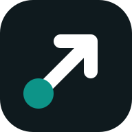
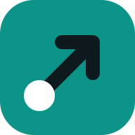

# First Mile Manager brand

The brand the marketing site, the help centre and the app all use. First Mile Manager stands on its own. It is not shown as part of any other product's brand.

## Name logo

| On light backgrounds | On dark backgrounds |
| --- | --- |
|  |  |
|  |  |

- `logo/fmm-lockup-light.svg` and `logo/fmm-lockup-dark.svg`: the mark and the name. Use these wherever there is room.
- `logo/fmm-mark-light.svg` and `logo/fmm-mark-dark.svg`: the mark alone, for favicons, app icons and tight spaces.

The mark is a pickup point with a route heading out. That is the first mile: collect from the client, send it on.

The name is set in Atkinson Hyperlegible Next Bold and turned into outlines, so the logo needs no font. Atkinson Hyperlegible is under the SIL Open Font License, which allows this. Write the name in full as "First Mile Manager". "FMM" is fine in internal notes, never on a customer-facing page.

Keep clear space around the logo of at least half the mark's height. Do not stretch it, recolour it, or put it on a busy picture.

## Colour

One accent: **Route teal `#0D9488`**. Everything else is ink and paper.

| Name | Hex | Use |
| --- | --- | --- |
| Route teal | `#0D9488` | Buttons, highlights, icons, the mark |
| Route teal (text) | `#0F766E` | Small accent text, such as links, on light backgrounds |
| Ink | `#0F1A1E` | Text on light backgrounds, and text on a Route teal fill |
| Paper | `#FFFFFF` | Light background |
| Night | `#0B1215` | Dark background |

Contrast (WCAG 2.2):

| Pair | Ratio | Meets |
| --- | --- | --- |
| Route teal on Paper | 3.74 : 1 | AA for buttons, icons and large text |
| Route teal on Night | 5.05 : 1 | AA for all text |
| Ink on Route teal | 4.73 : 1 | AA for all text (button labels) |
| Route teal (text) on Paper | 5.47 : 1 | AA for all text |
| Ink on Paper | 17.69 : 1 | AAA |

So: on light pages, use Route teal for fills and big type, and the text shade for small links. On dark pages, Route teal works for everything. Button labels on a Route teal fill are always Ink.

Route teal means "this is First Mile Manager", not a status. Status colours (success, warning, danger) stay the standard green, orange and red, and success green should look clearly different from Route teal.

The values are also in [`tokens.css`](tokens.css).

## Voice

We write for busy people at a loading bay, a desk or a van door. So:

- Use short sentences and everyday words. Say "book a collection", not "create a consignment request".
- Lead with what the reader can do or what has happened. Then add detail if it helps.
- Use the words in the product's glossary, the same way every time.
- Talk to the reader as "you" and about ourselves as "we". Be friendly and direct. No hype, no exclamation marks.
- Never name another product to a reader who only uses First Mile Manager. Pages written for people who use both products may say how they work together.
